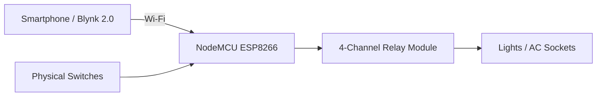

# Smart Extension Board | NodeMCU ESP8266 + Blynk 2.0

An IoT-enabled smart extension board that combines **manual switching** with **remote control through Blynk 2.0**.

The system uses a **NodeMCU ESP8266**, a 4-channel relay module, physical 2-way switches, and AC outputs to control lights and electrical sockets from either the hardware switches or a smartphone.

> **Safety note:** This project interfaces with AC mains voltage. Replication should only be attempted by people who understand electrical safety and safe isolation practices.

## Features

- Remote appliance control through **Blynk 2.0**
- Manual control using physical switches
- Four relay-controlled outputs
- Wi-Fi connectivity through NodeMCU ESP8266
- Hardware + software integration in one practical IoT system
- Manual override when remote control is not available

## System Architecture



## Circuit Diagram

The circuit diagram used in the project documentation will be stored in:

`media/circuit_diagram.jpeg`

Once uploaded, it will appear here:


## Hardware

- NodeMCU ESP8266
- 4-channel relay module
- Physical 2-way switches
- Light / AC socket outputs
- Jumper wires
- Power supply
- Wi-Fi network

## Software

- Arduino IDE
- Blynk 2.0
- ESP8266 Wi-Fi library
- Blynk Arduino library

## Control Logic

Blynk virtual pins are used to send commands from the mobile application to the NodeMCU. The microcontroller then changes the output state of the corresponding relay.

The relay outputs are configured so that each channel can control a connected load independently.

## Source Code

The public example in `src/smart_extension_board.ino` intentionally uses placeholders for:

- Blynk authentication token
- Wi-Fi SSID
- Wi-Fi password

Real credentials are **not stored in this repository**.

## Demo

A demonstration video can be added to:

`media/smart_extension_board_demo.mp4`

If the video is too large for GitHub, the repository can instead link to a YouTube, Google Drive, or other public demo URL.

## Repository Structure

```text
smart-extension-board-iot/
├── README.md
├── src/
│   └── smart_extension_board.ino
├── docs/
│   └── ATTRIBUTION.md
└── media/
    ├── circuit_diagram.jpeg
    └── smart_extension_board_demo.mp4
```

## What This Project Demonstrates

- Embedded programming
- IoT communication
- Relay-based load control
- Hardware/software integration
- Remote device control
- Practical troubleshooting and wiring
- Building a simple user-facing automation system

## Attribution

The original project documentation references external tutorials for parts of the circuit/code approach. Those sources are acknowledged in [docs/ATTRIBUTION.md](docs/ATTRIBUTION.md).

## Author

**Karan Chauhan**  
Robotics & Automation Engineer  
GitHub: [@karan-automation](https://github.com/karan-automation)
