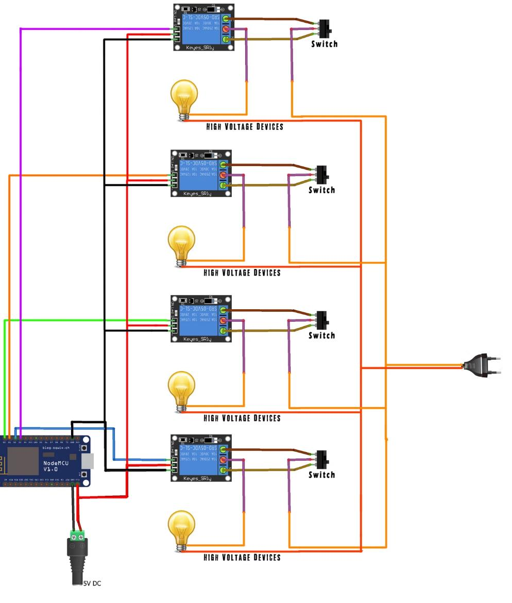
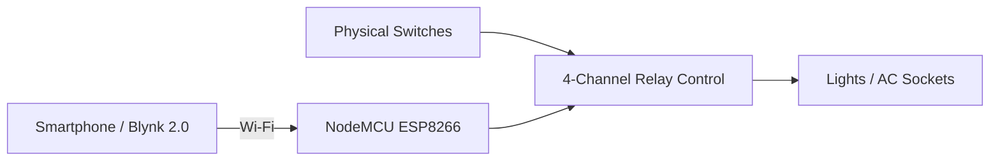

# Smart Extension Board | NodeMCU ESP8266 + Blynk 2.0

An IoT-enabled smart extension board combining **physical switching** with **remote smartphone control** through Blynk 2.0.

The system uses a **NodeMCU ESP8266**, four relay channels, physical switches and AC outputs to control connected loads through Wi-Fi while retaining local manual control.

> **Safety note:** This project interfaces with AC mains voltage. Replication should only be attempted by people who understand electrical safety, isolation and safe wiring practices.

## Project Demo

[▶ **Watch the working Smart Extension Board demonstration**](media/smart_extension_board_demo.mp4)

The demonstration shows the completed hardware operating as an integrated IoT control system.

## Circuit Diagram



The circuit diagram is included from the original project documentation as a reference for the hardware arrangement. See the [attribution notes](docs/ATTRIBUTION.md) for source details.

## What the System Does

- Controls multiple electrical loads through **Blynk 2.0**
- Provides local control through physical switches
- Uses four relay outputs driven by the NodeMCU ESP8266
- Connects to the Blynk cloud over Wi-Fi
- Keeps each output independently controllable
- Demonstrates practical integration of embedded software, electronics and a user-facing IoT interface

## System Architecture



## Hardware

- NodeMCU ESP8266
- 4-channel relay module
- Physical 2-way switches
- Lighting / AC socket outputs
- Jumper wires and wiring
- NodeMCU power supply
- Wi-Fi network

## Software

- Arduino IDE
- Blynk 2.0
- ESP8266 Wi-Fi library
- Blynk Arduino library

## Control Logic

Blynk virtual pins **V0-V3** are mapped to four relay channels. Commands sent from the mobile application are received by the ESP8266, which changes the state of the corresponding active-low relay output.

The public portfolio version of the code keeps the control logic easy to inspect while removing all private credentials.

## Source Code

See [`src/smart_extension_board.ino`](src/smart_extension_board.ino).

The repository intentionally uses placeholders for:

- Blynk authentication token
- Wi-Fi SSID
- Wi-Fi password

No private credentials are stored in the public repository.

## Repository Structure

```text
smart-extension-board-iot/
├── README.md
├── src/
│   └── smart_extension_board.ino
├── docs/
│   └── ATTRIBUTION.md
└── media/
    ├── circuit_diagram.jpeg
    └── smart_extension_board_demo.mp4
```

## Engineering Takeaways

This project gave me practical experience with:

- embedded C/C++ programming
- Wi-Fi connected devices
- relay-based load control
- hardware/software integration
- IoT application interfaces
- debugging wiring and control behaviour
- turning a prototype into a working user-facing automation device

## Attribution

The original project documentation references external tutorials for parts of the circuit and code approach. I have kept those sources explicit rather than presenting third-party material as original work.

See [`docs/ATTRIBUTION.md`](docs/ATTRIBUTION.md).

## Author

**Karan Chauhan**  
Robotics & Automation Engineer  
GitHub: [@karan-automation](https://github.com/karan-automation)  
LinkedIn: [Karan Chauhan](https://www.linkedin.com/in/karan-chauhan-425007212)